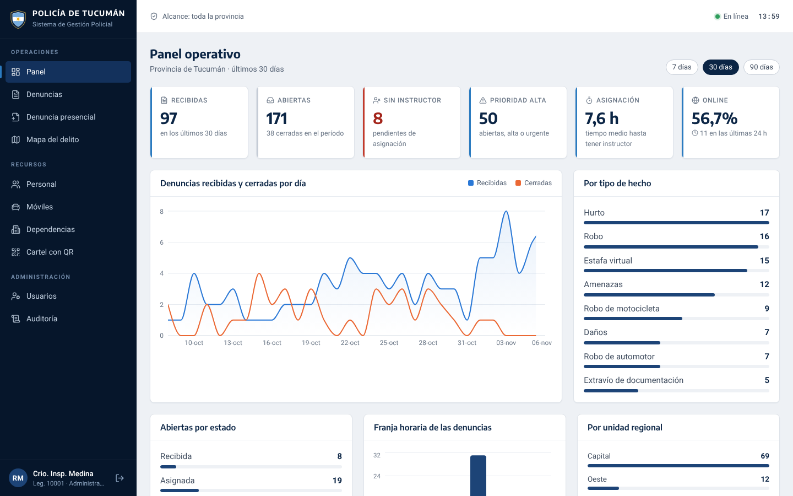
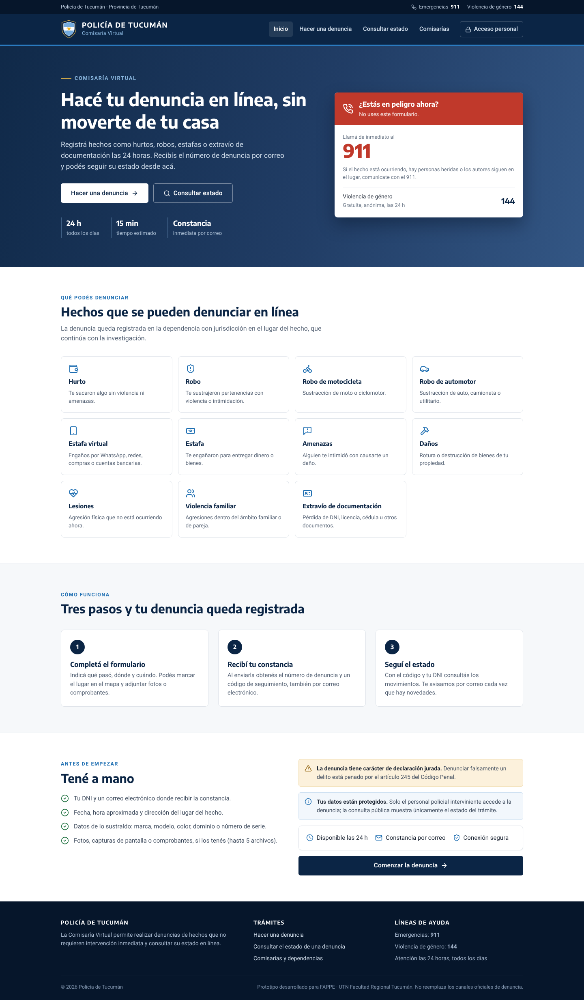
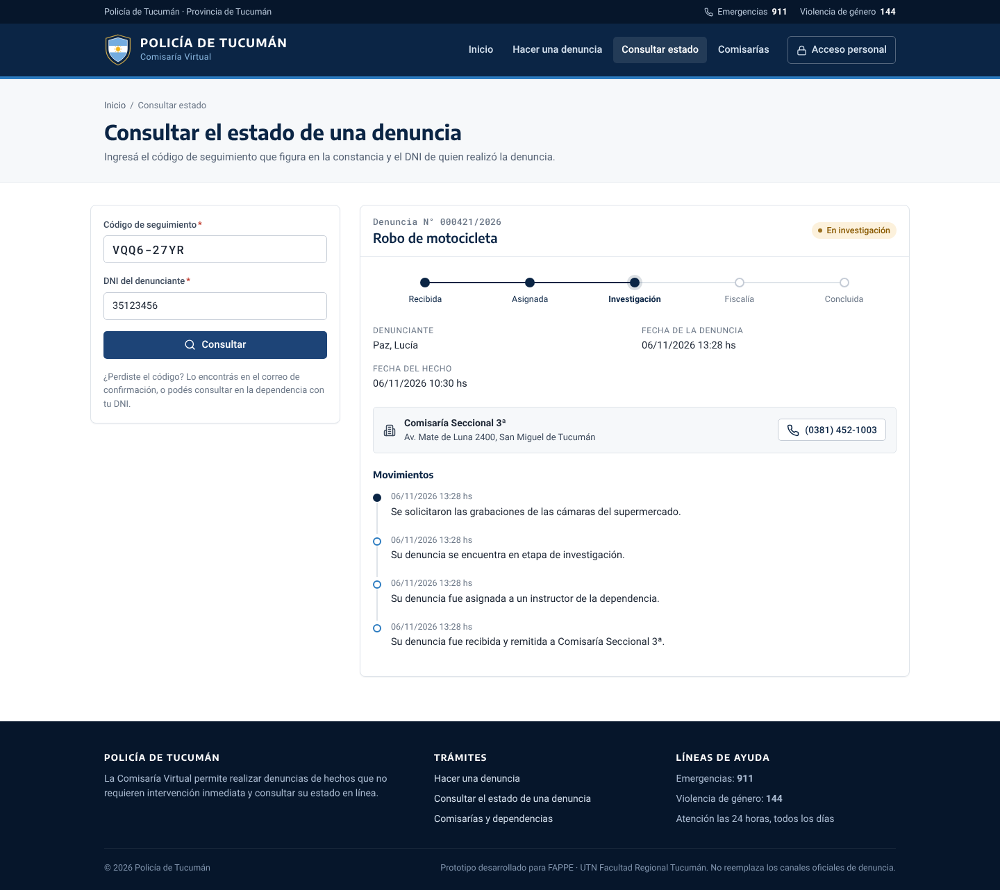
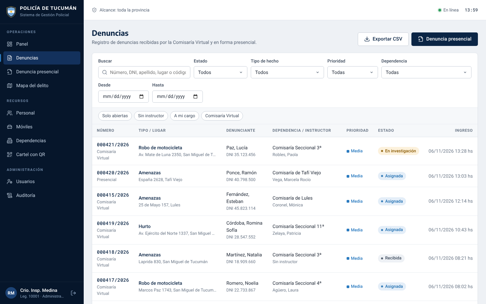
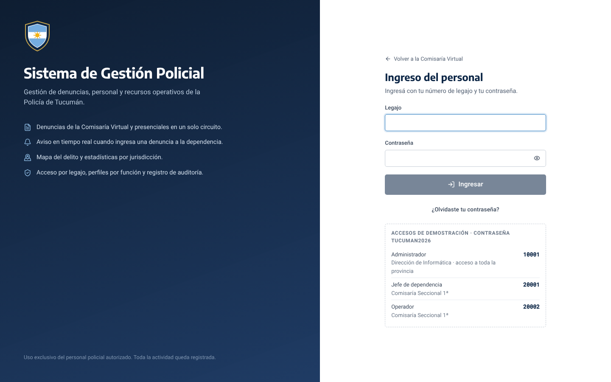
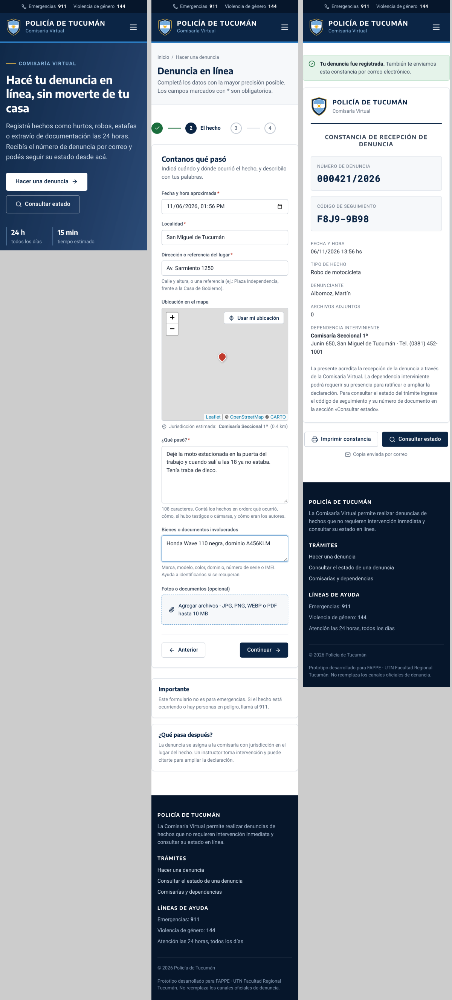

# Policía de Tucumán · Comisaría Virtual y Sistema de Gestión Policial

Plataforma web para que la ciudadanía haga denuncias en línea y siga su estado, y para que el personal policial las gestione desde la dependencia: asignación de instructor, actuaciones, derivaciones, estadísticas, mapa del delito, personal y móviles.

Proyecto presentado en FAPPE · UTN Facultad Regional Tucumán.



## Qué resuelve

**Comisaría Virtual (acceso público)**

- Denuncia en línea en cuatro pasos, con ubicación en el mapa y hasta cinco fotos o PDF.
- La denuncia se asigna sola a la comisaría con jurisdicción en el lugar del hecho (la más cercana).
- Constancia imprimible con número de denuncia y código de seguimiento, que también llega por correo.
- Consulta del estado con código + DNI: etapas del trámite y movimientos informados por la dependencia.
- Listado y mapa de comisarías de toda la provincia.

**Sistema de Gestión Policial (intranet)**

- Ingreso por legajo, con tres perfiles: administrador (toda la provincia), jefe de dependencia y operador.
- Panel operativo con indicadores, evolución diaria, tipos de hecho, franjas horarias y unidades regionales.
- Aviso en tiempo real cuando entra una denuncia a la dependencia, sin recargar la página.
- Expediente de cada denuncia: designación de instructor según carga de trabajo, cambios de estado con fundamento, derivación a otra dependencia, notas internas o informadas al denunciante, archivos.
- Carga de denuncias presenciales en mesa de entradas.
- Mapa del delito filtrable por período y tipo.
- Personal (jerarquía, situación de revista, destino), móviles y dependencias.
- Usuarios con contraseña temporal, bloqueo por intentos fallidos y recuperación por correo.
- Auditoría de todas las operaciones y bandeja de los correos enviados.
- Exportación a CSV y cartel imprimible con código QR para las dependencias.

### Capturas

| | |
|---|---|
|  |  |
|  |  |
|  |  |

## Arquitectura

```
                         ┌──────────────── VPS (Docker Compose) ────────────────┐
 Navegador ──HTTPS──▶ Nginx del VPS ──▶ web (Nginx + React) ──/api, /hubs──▶ api (.NET 8)
                     (certificado)      │                                      │   │
                                        └── archivos estáticos                 │   └──▶ db (PostgreSQL 16)
                                                                               │
                                                       bandeja de salida ──▶ mailer (Node + Nodemailer) ──▶ SMTP
```

| Capa | Tecnología |
|---|---|
| Frontend | React 18 + Vite + TypeScript, React Router, TanStack Query, Recharts, Leaflet |
| Backend | C# · ASP.NET Core 8 (Web API), Entity Framework Core, SignalR, JWT |
| Base de datos | PostgreSQL 16 (migraciones con EF Core) |
| Correo | Microservicio Node.js con Nodemailer |
| Infraestructura | Docker Compose, Nginx como proxy inverso, Let's Encrypt |

El backend está separado en tres proyectos: `Domain` (entidades y reglas de negocio, sin dependencias), `Infrastructure` (EF Core, correo, almacenamiento) y `Api` (controladores, seguridad, tiempo real). Más detalle en [docs/ARQUITECTURA.md](docs/ARQUITECTURA.md).

## Levantarlo con Docker

Requisitos: Docker con el plugin Compose.

```bash
cp .env.example .env      # completar claves; para probar en la PC alcanza con poner WEB_PUERTO=8080
docker compose up -d --build
```

Abrir <http://localhost:8080> (o el puerto elegido). La primera vez se crea la base y, con `DATOS_DEMO=true`, se cargan 33 dependencias distribuidas en las cinco unidades regionales, 224 efectivos, 90 móviles y seis meses de denuncias de ejemplo.

### Usuarios de demostración

Contraseña de todos: el valor de `ADMIN_PASSWORD` (por defecto `Tucuman2026`). La pantalla de ingreso los muestra cuando la demo está activa.

| Legajo | Perfil | Alcance |
|---|---|---|
| `10001` | Administrador | Toda la provincia |
| `20001` | Jefe de dependencia | Comisaría Seccional 1ª |
| `20002` | Operador | Comisaría Seccional 1ª |

## Desarrollo local sin Docker

Requisitos: .NET SDK 8, Node.js 20 o superior y PostgreSQL 14 o superior.

```bash
# API (http://localhost:5080, documentación en /api/docs)
cd backend/src/PoliciaTucuman.Api
dotnet run            # usa appsettings.Development.json: base "policia_tucuman" en localhost, usuario postgres/postgres

# Servicio de correo (sin SMTP guarda los correos como .html en mailer/salida/)
cd mailer && npm install && MAILER_API_KEY=desarrollo npm run dev

# Frontend (http://localhost:5173, con proxy a la API)
cd frontend && npm install && npm run dev
```

Para cambiar el modelo de datos: `dotnet ef migrations add NombreDelCambio -p src/PoliciaTucuman.Infrastructure -s src/PoliciaTucuman.Api -o Persistencia/Migraciones` desde `backend/`. Las migraciones se aplican solas al iniciar la API.

## Correos

La API no envía correos directamente: los guarda en la tabla `correos_salientes` dentro de la misma transacción que la operación (patrón *outbox*) y un proceso en segundo plano los entrega al servicio `mailer`, que los envía con Nodemailer. Si el servidor SMTP no responde, se reintenta con espera creciente y el estado se ve en **Auditoría → Correos**.

Se envían: constancia de denuncia, novedades al denunciante (cambios de estado y notas informadas), aviso a la dependencia, credenciales de usuarios nuevos y restablecimiento de contraseña.

Para usar Gmail: activar la verificación en dos pasos, crear una contraseña de aplicación en <https://myaccount.google.com/apppasswords> y cargarla en `SMTP_PASS`.

## Despliegue

Guía paso a paso para un VPS de Hostinger (Ubuntu, 4 GB de RAM) en [docs/DESPLIEGUE.md](docs/DESPLIEGUE.md). En resumen:

```bash
git clone -b policia-tucuman <url-del-repositorio> /opt/policia-tucuman
cd /opt/policia-tucuman
sudo bash deploy/instalar-vps.sh denuncias.midominio.com.ar correo@midominio.com.ar
```

## Tests

```bash
cd backend && dotnet test     # reglas de negocio, jurisdicción, validación de archivos, reintentos, CSV
cd mailer && npm test         # plantillas de correo
cd frontend && npm run build  # chequeo de tipos y compilación
```

## Estructura

```
backend/
  src/PoliciaTucuman.Domain/          entidades, enums y reglas (flujo de estados, jurisdicción, prioridades)
  src/PoliciaTucuman.Infrastructure/  EF Core + PostgreSQL, migraciones, datos iniciales, correo, archivos
  src/PoliciaTucuman.Api/             controladores por módulo, JWT, SignalR, manejo de errores
  tests/PoliciaTucuman.Tests/         xUnit
frontend/
  src/publico/                        Comisaría Virtual
  src/intranet/                       Sistema de Gestión Policial
  src/componentes/                    formulario de denuncia, mapas, componentes de interfaz
  nginx/default.conf                  servidor web y proxy hacia la API
mailer/                               servicio de correo (Express + Nodemailer) y plantillas
deploy/                               instalación en el VPS, Nginx, respaldos y actualización
docs/                                 arquitectura, despliegue y guion de presentación
```

---

Los nombres de personas, legajos, DNI, teléfonos y denuncias de la demo son ficticios. Las dependencias y sus ubicaciones son aproximadas y se usan solo como ejemplo. El escudo es un diseño propio del proyecto; para un uso institucional se reemplaza `frontend/public/escudo.svg` y `mailer/assets/escudo.png`.
